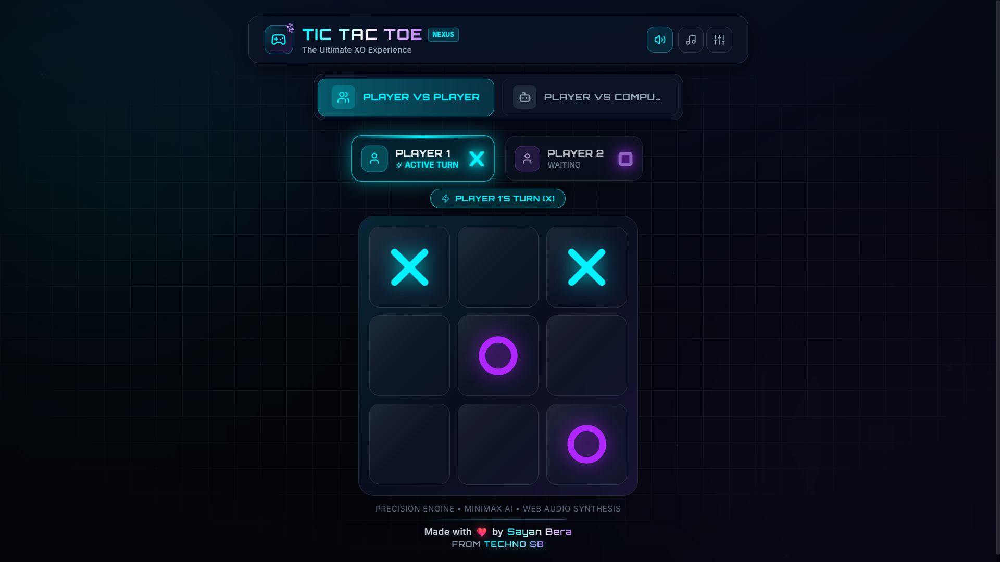
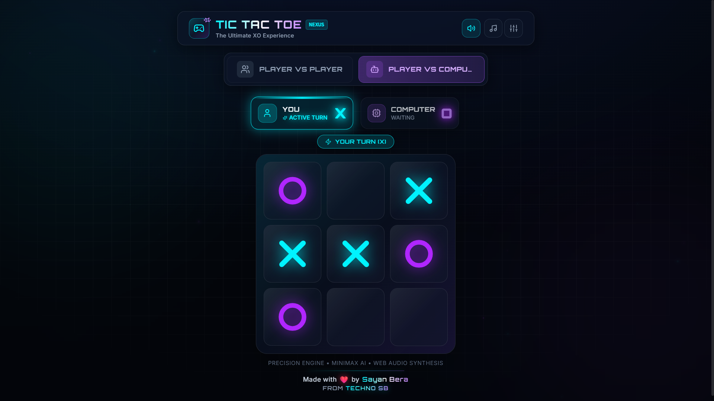
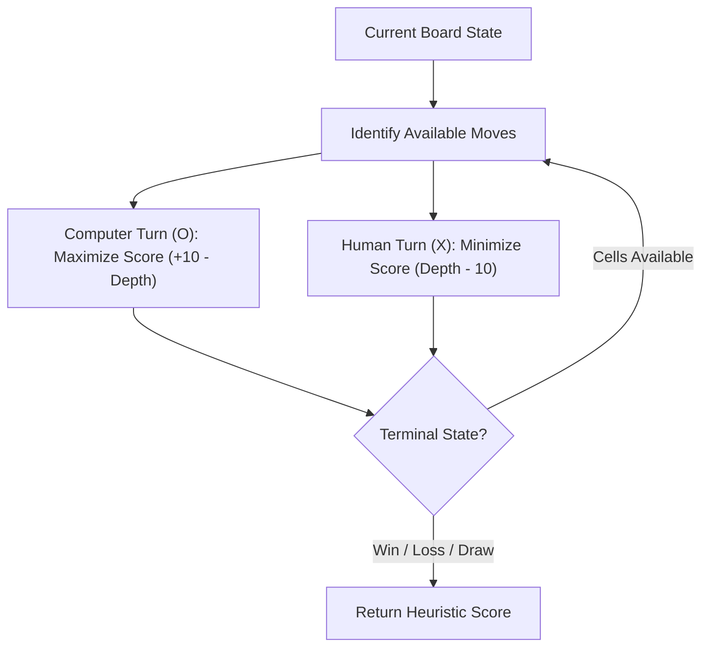

<div align="center">

# NEXUS TIC TAC TOE

### *The Ultimate XO Experience*

A premium futuristic Tic Tac Toe gaming experience powered by intelligent Minimax AI, immersive audio synthesis, smooth animations, and a modern glassmorphism interface.

<br/>

[](https://react.dev/)
[](https://vitejs.dev/)
[](https://tailwindcss.com/)
[](https://developer.mozilla.org/en-US/docs/Web/JavaScript)
[](https://www.framer.com/motion/)
[](https://lucide.dev/)
[](https://developer.mozilla.org/en-US/docs/Web/API/Web_Audio_API)

</div>

---

## 📑 Table of Contents

- [🎮 Game Preview](#game-preview)
- [🌌 About Nexus Tic Tac Toe](#about-nexus-tic-tac-toe)
- [✨ Key Features](#key-features)
- [🖼️ Gameplay Showcase](#gameplay-showcase)
- [🛠️ Built With](#built-with)
- [🧠 Minimax AI Engine](#minimax-ai-engine)
- [📁 Project Structure](#project-structure)
- [🚀 Getting Started](#getting-started)
- [🎯 How to Play](#how-to-play)
- [📱 Responsive Experience](#responsive-experience)
- [🎵 Immersive Audio Experience](#immersive-audio-experience)

---

## <a id="game-preview"></a>🎮 Game Preview

Nexus Tic Tac Toe offers two distinct gameplay modes tailored for both social multiplayer and solo challenge:

1. **Player vs Player (PvP)**: Two human players take alternating turns on the same device.
2. **Player vs Computer (PvC)**: Challenge an unbeatable computer opponent powered by the zero-sum recursive Minimax algorithm.

<br/>

<div align="center">

<table align="center">
  <thead>
    <tr>
      <th align="center">👥 PLAYER VS PLAYER</th>
      <th align="center">🤖 PLAYER VS COMPUTER</th>
    </tr>
  </thead>
  <tbody>
    <tr>
      <td align="center">
        
      </td>
      <td align="center">
        
      </td>
    </tr>
    <tr>
      <td align="center">
        <em>Local head-to-head match with dynamic turn glows and neon laser victory lines</em>
      </td>
      <td align="center">
        <em>Challenging the unbeatable Minimax AI with real-time thinking status feedback</em>
      </td>
    </tr>
  </tbody>
</table>

</div>

---

## <a id="about-nexus-tic-tac-toe"></a>🌌 About Nexus Tic Tac Toe

**Nexus Tic Tac Toe** reimagines the classic 3×3 game as a modern, interactive cyberpunk web application. Built using **React 18**, **Vite**, and **Tailwind CSS**, it combines sleek visuals with clean frontend architecture:

### Project Highlights
- **Dark Glassmorphism Interface**: Multi-layered backdrop blurs (`backdrop-filter: blur(16px)`), subtle translucent borders, and a deep midnight obsidian theme.
- **Electric Aesthetics**: High-energy Electric Cyan (`#00f3ff`) for Player 1 / You and Neon Purple (`#b026ff`) for Player 2 / Computer.
- **Intelligent Minimax-Based Opponent**: Powered by an optimal Minimax decision algorithm with depth-weighted heuristics, ensuring that the computer always selects the mathematically optimal move.
- **Procedural Web Audio Synthesis**: Procedurally synthesized ambient background soundscapes and real-time sound effects generated natively through the browser's Web Audio API.
- **Modular React Architecture**: Structured with clear separation of concerns, custom React hooks, automated game-logic and E2E test scripts, and mobile-first responsive styling.

---

## <a id="key-features"></a>✨ Key Features

### 🕹️ Game Modes
- **Player vs Player**: Direct local turn-based play for two human participants on a shared screen.
- **Player vs Computer**: Single-player tactical match against the Minimax computer opponent.
- **Alternating Turns**: Deterministic state transitions with immediate visual feedback.
- **Real-Time Indicators**: Dynamic status cards displaying the active player with glowing borders.

### 🧠 AI Engine
- **Minimax Algorithm**: Recursive zero-sum evaluation ensuring the computer never makes an invalid or sub-optimal move.
- **Depth-Weighted Scoring**: Prioritizes faster victories while maintaining persistent defense against human traps.
- **AI Thinking Indicator**: A natural 550ms–750ms delay paired with the visual UI status text `"AI NEURAL SYSTEM COMPUTING..."` to provide clear feedback during the computer's turn (the actual opponent is driven by the Minimax algorithm, not a neural network).
- **Input Locking**: Prevents human clicks during the computer's turn to eliminate race conditions.

### 🎮 Game Experience
- **Interactive 3×3 Glass Grid**: Large, clickable cells with micro-hover scaling and turn previews.
- **Animated Symbols**: Smooth SVG scale-in transitions for Electric Cyan `X` and Neon Purple `O`.
- **Winning Line Animation**: Dynamic SVG laser stroke slicing across any completed three-in-a-row combination.
- **Match Result Screen**: Victory and draw celebration overlay featuring trophy animation and particle confetti (`canvas-confetti`).
- **Restart Match Functionality**: Clears the board and resets turns while preserving the active game mode (only accessible after a match ends).
- **Mode-Switch Confirmation Modal**: Glassmorphism safety dialog that prevents accidental match resets while a game is actively in progress.

### 🎵 Audio Experience
- **Procedural Background Music**: Continuous, relaxing synth pad progression (Em7, Cmaj7, G, Dsus2) with gentle lowpass filter sweeps and ambient bell chimes.
- **10 Distinct Sound Effects**: Low-latency synthesized sound effects for every interaction.
- **Independent Controls**: Separate toggle buttons for background music and sound effects.
- **Volume Slider**: Smooth popover slider for master volume adjustment.
- **Persistent Preferences**: Saves audio mute states and volume levels across sessions in `localStorage`.
- **Audio Autoplay Compliance**: Safely unlocks the browser's `AudioContext` upon the user's initial interaction.

### 🎨 UI/UX & Design
- **Theme Palette**: Deep Midnight Obsidian (`#03050a`), Electric Cyan (`#00f3ff`), and Neon Purple (`#b026ff`).
- **Ambient Lighting Effects**: Slow-moving radial gradient orbs, floating particles, and a subtle holographic background grid.
- **Framer Motion Animations**: Physics-based transitions for layout changes, cards, and modal dialogs.
- **Responsive Layout**: Designed to comfortably fit within `100dvh` without unintended horizontal overflow.
- **Accessible Design**: Keyboard navigation support, visible focus rings, ARIA roles, and `@media (prefers-reduced-motion)` compatibility.

---

## <a id="gameplay-showcase"></a>🖼️ Gameplay Showcase

The application delivers tailored interaction mechanics and visual states for each gameplay mode:

### 1. Player vs Player (PvP)
- **Local Duel**: Two players alternate turns locally on a shared device.
- **Color Coding**: Player 1 commands Electric Cyan `X`, while Player 2 commands Neon Purple `O`.
- **Turn Feedback**: Active player cards display glowing borders and real-time status pulses.
- **Laser Strike**: Completing any 3-in-a-row combination automatically draws an animated neon laser line matching the victor's color.

### 2. Player vs Computer (PvC)
- **Tactical Matchup**: The human player plays as `X`, competing against the computer as `O`.
- **Input Locking & Thinking Delay**: While the computer calculates its response, grid interaction is temporarily locked, and the indicator displays the UI status `"AI NEURAL SYSTEM COMPUTING..."` alongside an animated spinner. Note that this is purely visual UI status text; the computer opponent is driven by the Minimax algorithm, not a neural network.
- **Infallible Move Selection**: The underlying Minimax algorithm evaluates all remaining outcomes to guarantee an AI win or a defensive draw.
- **End-of-Match Flow**: A victory or draw celebration overlay presents an instant **Restart Match** action that clears the grid while keeping the active mode selected.

---

## <a id="built-with"></a>🛠️ Built With

### Runtime Technologies & Libraries

| Technology | Exact Version | Purpose |
| :--- | :--- | :--- |
| **[React](https://react.dev/)** | `18.3.1` | Component-based UI architecture, state management, and custom React hooks |
| **[React DOM](https://react.dev/)** | `18.3.1` | DOM rendering for React components |
| **[Vite](https://vitejs.dev/)** | `5.4.11` | Build tool and fast local development server |
| **[Tailwind CSS](https://tailwindcss.com/)** | `3.4.15` | Utility-first styling, custom color variables, and glassmorphism backdrops |
| **[Framer Motion](https://www.framer.com/motion/)** | `11.11.17` | Layout transitions, spring animations, modal scaling, and SVG path drawing |
| **[Lucide React](https://lucide.dev/)** | `0.460.0` | High-tech icons (`Gamepad2`, `Bot`, `Users`, `Volume2`, `Trophy`, etc.) |
| **[Canvas Confetti](https://www.npmjs.com/package/canvas-confetti)** | `1.9.3` | Particle celebration effect on match victory |
| **[Web Audio API](https://developer.mozilla.org/en-US/docs/Web/API/Web_Audio_API)** | Native API | Procedural background synth music and 10 synthesized sound effects |

### Development & Testing Tools

| Tool | Exact Version | Purpose |
| :--- | :--- | :--- |
| **[Playwright](https://playwright.dev/)** | `1.65.0` | Headless browser automation for end-to-end testing and viewport validation |
| **[Autoprefixer](https://github.com/postcss/autoprefixer)** | `10.4.20` | CSS vendor prefixing via PostCSS |
| **[PostCSS](https://postcss.org/)** | `8.4.49` | CSS processing pipeline for Tailwind CSS |

---

## <a id="minimax-ai-engine"></a>🧠 Minimax AI Engine

The computer opponent (`O`) is driven by the **Minimax algorithm**, a foundational decision rule from game theory for two-player, zero-sum games with perfect information.

### Algorithm Concept



1. **Maximizing and Minimizing Players**:
   - The Computer (`O`) acts as the **maximizing player**, choosing moves that lead to the highest possible score.
   - The Human (`X`) is modeled as the **minimizing player**, choosing moves that minimize the computer's score.
2. **Terminal Scoring Heuristics**:
   - **Computer Victory**: `+10 - depth` (rewards faster wins with fewer moves).
   - **Human Victory**: `depth - 10` (penalizes losses and incentivizes delay).
   - **Draw**: `0` points.
3. **State Space & Search Performance**:
   - While `3^9 = 19,683` represents the theoretical upper bound of all possible cell assignments (3 possible states for each of the 9 cells), this is not the number of valid game sequences. The count of legal, reachable game states in actual play is far smaller due to alternating turn parity, symmetry, and game-terminating win conditions.
   - Because the state space is compact, the algorithm computes every possible outcome in milliseconds, making the computer opponent mathematically impossible to defeat.

### Implementation Snippet (`src/utils/minimax.js`)

```javascript
function minimaxScore(board, depth, isMaximizing) {
  const winResult = checkWinner(board);

  if (winResult) {
    if (winResult.winner === COMPUTER) {
      return 10 - depth;
    } else if (winResult.winner === HUMAN) {
      return depth - 10;
    }
  }

  const availableMoves = getAvailableMoves(board);
  if (availableMoves.length === 0) {
    return 0; // Draw
  }

  if (isMaximizing) {
    let maxEval = -Infinity;
    for (const move of availableMoves) {
      board[move] = COMPUTER;
      const evaluation = minimaxScore(board, depth + 1, false);
      board[move] = null;
      maxEval = Math.max(maxEval, evaluation);
    }
    return maxEval;
  } else {
    let minEval = Infinity;
    for (const move of availableMoves) {
      board[move] = HUMAN;
      const evaluation = minimaxScore(board, depth + 1, true);
      board[move] = null;
      minEval = Math.min(minEval, evaluation);
    }
    return minEval;
  }
}
```

---

## <a id="project-structure"></a>📁 Project Structure

```
TicTacToe/
├── index.html                   # HTML template loading fonts (Orbitron, Rajdhani, Inter)
├── package.json                 # Project dependencies, scripts, and package metadata
├── postcss.config.js            # PostCSS configuration for Tailwind CSS
├── tailwind.config.js           # Custom theme colors, keyframes, glows, and extensions
├── vite.config.js               # Vite bundler configuration (dev server port 3000)
├── README.md                    # Project documentation
├── .gitignore                   # Git ignore rules (node_modules, dist, logs, etc.)
│
├── scripts/
│   ├── e2e-test.js              # Playwright automated E2E browser test suite
│   ├── generate-audio.js        # Node script generating fallback audio assets
│   └── test-game-logic.js       # Unit test runner for game logic and Minimax simulation
│
└── src/
    ├── App.jsx                  # Main application orchestrator and modal host
    ├── main.jsx                 # React root entry point
    ├── index.css                # Base Tailwind directives and custom scrollbar styles
    │
    ├── assets/
    │   ├── audio/               # Standalone audio fallback files
    │   │   ├── background-music.mp3
    │   │   ├── click.mp3
    │   │   ├── draw.mp3
    │   │   ├── move.mp3
    │   │   └── win.mp3
    │   └── images/              # Verified gameplay screenshots
    │       ├── pvp-gameplay.png
    │       └── pvc-gameplay.png
    │
    ├── components/
    │   ├── AudioControls.jsx    # Music/sound toggle buttons and volume popover
    │   ├── BackgroundEffects.jsx# Ambient glowing orbs, floating particles, and cyber grid
    │   ├── ConfirmModal.jsx     # Safe mode-switch reset confirmation modal
    │   ├── Footer.jsx           # Natural footer with pulsing heart and credits
    │   ├── GameBoard.jsx        # 3×3 glassmorphism board grid container
    │   ├── GameCell.jsx         # Individual cell button with animated SVG X & O
    │   ├── GameModeSelector.jsx # PvP vs PvC mode switcher with spring indicator
    │   ├── Header.jsx           # Game title, branding logo, and audio dock
    │   ├── PlayerCard.jsx       # Player information cards with turn glows and avatars
    │   ├── ResultModal.jsx      # Victory/Draw celebration overlay & restart match trigger
    │   ├── TurnIndicator.jsx    # Dynamic status badge with AI thinking indicator
    │   └── WinningLine.jsx      # SVG laser strike across 8 winning combinations
    │
    ├── hooks/
    │   ├── useAudio.js          # Procedural ambient synth & 10 Web Audio sound effects
    │   ├── useComputer.js       # AI move scheduler with thinking delay & click locking
    │   └── useGame.js           # Core state management, move validation, and mode resets
    │
    ├── styles/
    │   ├── animations.css       # Keyframes for neon pulses, heartbeat, and laser sweeps
    │   └── custom.css           # Glassmorphism classes and custom volume slider styling
    │
    └── utils/
        ├── constants.js         # Game modes, player configs, and winning line coordinates
        ├── gameLogic.js         # Win detection, draw evaluation, and board factories
        └── minimax.js           # Unbeatable zero-sum Minimax decision tree engine
```

---

## <a id="getting-started"></a>🚀 Getting Started

Follow these steps to run the project locally.

### Prerequisites
- **Node.js**: `v18.0.0` or higher
- **npm**: `v9.0.0` or higher
- **Git**: Installed on your system

### 1. Clone the Repository
```bash
git clone https://github.com/USERNAME/Nexus-Tic-Tac-Toe.git
```
*(Replace `USERNAME` with your GitHub username)*

### 2. Enter the Project Directory
```bash
cd Nexus-Tic-Tac-Toe
```

### 3. Install Dependencies
```bash
npm install
```

### 4. Start the Development Server
```bash
npm run dev
```
Open your browser at `http://localhost:3000` (configured in `vite.config.js`).

### 5. Build for Production
```bash
npm run build
```

### 6. Preview the Production Build
```bash
npm run preview
```

### 7. Run Automated Tests
```bash
# Step 1: Build the production bundle
npm run build

# Step 2: Run game logic & Minimax simulation tests
node scripts/test-game-logic.js

# Step 3: Run Playwright headless browser E2E tests
# (Install the Playwright Chromium browser if running for the first time)
npx playwright install chromium
node scripts/e2e-test.js
```

---

## <a id="how-to-play"></a>🎯 How to Play

### Mode 1: Player vs Player
1. Select **PLAYER VS PLAYER** in the mode selector.
2. **Player 1** starts with **X (Electric Cyan)**.
3. **Player 2** follows with **O (Neon Purple)**.
4. Players take alternating turns by selecting open cells on the grid.
5. The first player to align three matching symbols horizontally, vertically, or diagonally wins.

### Mode 2: Player vs Computer
1. Select **PLAYER VS COMPUTER** in the mode selector.
2. The human plays as **X (Electric Cyan)**; the computer plays as **O (Neon Purple)**.
3. Place your symbol on any open square.
4. The computer displays `"AI NEURAL SYSTEM COMPUTING..."` (UI status text), locks input, computes the optimal square via the Minimax algorithm, and places its move after a subtle thinking delay.
5. Aim to create an airtight defense to achieve a draw against the optimal AI.

### Mode Switching & Reset Confirmation
- If a match is in progress and moves have been made, attempting to switch modes triggers a confirmation dialog:
  > *"Switching game mode will reset the current match. All existing X and O moves will be removed. Do you want to continue?"*
- Clicking **CANCEL** closes the modal and keeps all existing moves intact.
- Clicking **OK** resets the board and starts a fresh match in the selected mode.
- If no moves have been played or the game is finished, modes switch immediately without a confirmation prompt.

### Restarting a Match
- No restart button is displayed during an active game to prevent accidental resets.
- Once a match ends in victory or a draw, the **Result Screen** appears with a prominent **RESTART MATCH** button.
- Clicking restart clears all cells, sets the turn back to Player 1 (`X`), and keeps you in your currently selected mode.

---

## <a id="responsive-experience"></a>📱 Responsive Experience

Nexus Tic Tac Toe is styled with a mobile-first responsive architecture designed to adapt across different screen resolutions:

- **100dvh Layout Structure**: Configured with `min-height: 100dvh` and Flexbox distribution to keep the header, player cards, game board, and footer visible without forced overflow.
- **Touch-Friendly Controls**: Grid cells and interactive buttons provide ample touch surface area and instant active state feedback for mobile touchscreens.
- **Horizontal Overflow Validation**: Automated E2E testing with Playwright verifies that `document.documentElement.scrollWidth <= window.innerWidth` across eight standard viewport dimensions:
  - Mobile Small: `320 × 640`
  - Mobile Standard: `375 × 667`
  - Mobile Medium: `390 × 844`
  - Mobile Large: `430 × 932`
  - Tablet Portrait: `768 × 1024`
  - Tablet / Laptop Landscape: `1024 × 768`
  - Desktop HD: `1366 × 768`
  - Desktop Full HD: `1920 × 1080`

---

## <a id="immersive-audio-experience"></a>🎵 Immersive Audio Experience

Audio in Nexus Tic Tac Toe is synthesized in real time via the browser's native **Web Audio API**:

### Background Music
- **Procedural Synth Pad**: Plays an evolving, continuous chord progression (Em7, Cmaj7, G, Dsus2) with gentle lowpass filter sweeps and subtle celestial twinkles.
- **Lightweight & Standalone**: Requires no external audio streams or network downloads.

### 10 Distinct Synthesized Sound Effects
Every user action maps to a dedicated Web Audio synthesizer function in `src/hooks/useAudio.js`:
1. **Button Click** (`playButtonClick`): Crisp 800Hz-to-400Hz frequency blip.
2. **X Move** (`playXMove`): Dual-oscillator electric cyan laser chime with bandpass filter.
3. **O Move** (`playOMove`): Warm neon purple resonant sub-bass harmonic ping.
4. **Turn Change** (`playTurnChange`): Subtle 440Hz-to-520Hz frequency shift.
5. **Win** (`playWin`): Celebratory 5-note cyberpunk arpeggio fanfare (C5, E5, G5, C6, E6).
6. **Draw** (`playDraw`): 3-voice minor chord drone (220Hz, 277Hz, 329Hz).
7. **Restart** (`playRestart`): Ascending 220Hz-to-880Hz pitch sweep.
8. **Mode Switch** (`playModeSwitch`): Holographic transition tone (350Hz–700Hz–500Hz).
9. **Modal Open** (`playModalOpen`): 300Hz-to-600Hz cinematic riser sweep.
10. **Modal Close** (`playModalClose`): 550Hz-to-280Hz descending dismissal tap.

### Audio Controls & Persistence
- **Dual Toggles**: Background music and sound effects can be toggled on/off independently.
- **Volume Popover Slider**: Master volume slider for precise output level control.
- **localStorage Memory**: User preferences are automatically persisted across page reloads.
- **Browser Autoplay Compliance**: The `AudioContext` initializes safely and activates on the user's first page interaction.

---

<p align="center">
  <strong>NEXUS TIC TAC TOE</strong><br/>
  <em>The Ultimate XO Experience</em>
</p>

<p align="center">
  Made with ❤️ by <strong>Sayan Bera</strong><br/>
  From <strong>TECHNO SB</strong>
</p>
